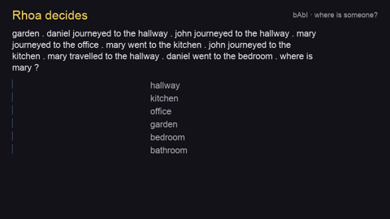
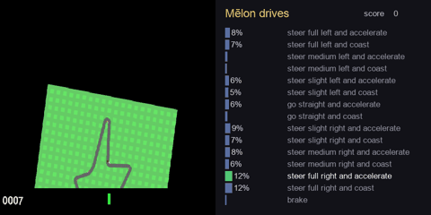
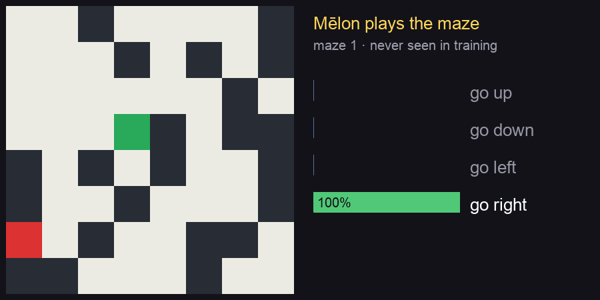
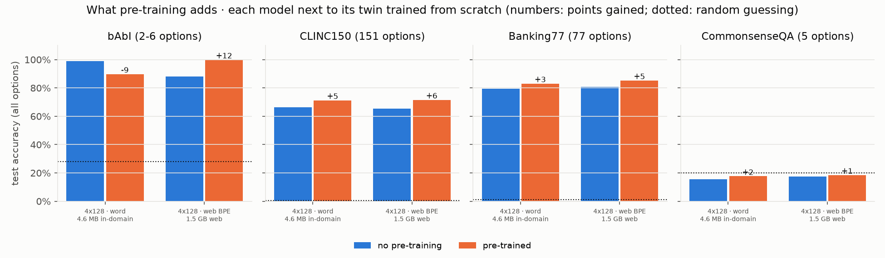
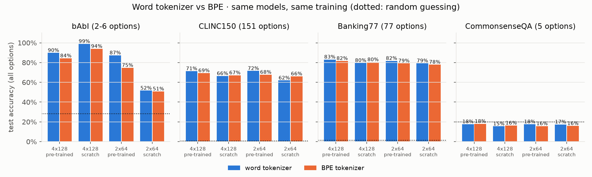
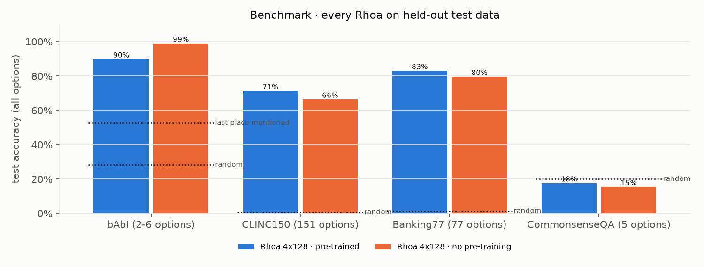

# tiny-dlms

Two tiny **decision models**, built from scratch in PyTorch. They don't write: they look at a situation and its
options, score every option and pick one. Every piece is hand-written: tokenizers, Transformer, pre-training,
fine-tuning, image model, benchmark, health checks and a browser demo. No Hugging Face `transformers`.

| | Reads | Decides | Best result (held-out test data) |
|---|---|---|---|
| **Rhoa** (ῥόα, *the pomegranate*) | text | the answer, the intent, the choice | **100%** bAbI · **72.6%** CLINC150 (151 options) · **85.3%** Banking77 (77 options) |
| **Mēlon** (μῆλον, *the golden apple*) | images | how to steer a car, the next move in a maze | drives **913**, equal to its teacher · solves **97%** of new mazes |

<p>
  
  
  
</p>

**Project page:** https://benisalla.github.io/tiny-dlms/ · try Rhoa in your browser, videos, full benchmark.

**How each model is built:** [Rhoa](docs/rhoa.md) · [Mēlon](docs/melon.md) · [the data](docs/02-data.md)

## What was built

- **Two tokenizers, from scratch:** a word tokenizer and a byte-level BPE (GPT-2 style), trained on our own data.
- **Rhoa:** a Transformer encoder with RMSNorm, RoPE and SwiGLU (GPT-2-style blocks as an option) that scores
  `<cls> context <sep> option` pairs.
- **Pre-training:** masked-token pre-training on 2 GB of web text (FineWeb-Edu, 479M tokens), streamed from disk.
- **Fine-tuning:** one model trained on 4 datasets at once (bAbI, CLINC150, Banking77, CommonsenseQA).
- **Mēlon:** the same judge on image patches. It learns to drive in CarRacing from a teacher, and to solve mazes.
- **Benchmark:** 16 Rhoa versions and 4 Mēlon versions tested on the same held-out data, next to simple baselines.
- **Health checks before every long run:** 15 for Rhoa, 11 for the car, 8 for the maze.
- **Web demo:** the best Rhoa exported to ONNX, running in the browser with the same tokenizer rewritten in JavaScript.
- **Plots, demo videos and a Colab notebook.**

## Results

Measured on **held-out test data** (never used for training or for choosing a checkpoint), with **all** the options.

### Real pre-training on web text

Each model pre-trained on web text next to its twin: the same size, tokenizer and fine-tuning, without pre-training.



| Test accuracy: twin / pre-trained (gain) | bAbI | CLINC150 | Banking77 | CommonsenseQA |
|---|---|---|---|---|
| Rhoa 4x128, 1.5 GB of web text | 88.1 / **99.9** (+11.8) | 65.4 / 71.6 (+6.2) | 80.6 / **85.3** (+4.7) | 17.4 / 18.5 (+1.1) |
| Rhoa 4x128, 2 GB of web text | 88.1 / **100.0** (+11.9) | 65.4 / **72.6** (+7.2) | 80.6 / 84.4 (+3.8) | 17.4 / 20.8 (+3.4) |
| Rhoa 2x64, 2 GB of web text | 71.5 / 81.4 (+9.9) | 63.2 / 67.6 (+4.4) | 79.3 / 83.0 (+3.7) | 17.0 / 17.6 (+0.6) |
| Rhoa GPT-2 blocks, 2 GB of web text | 49.6 / 99.7 (**+50.1**) | 64.9 / 68.4 (+3.5) | 77.3 / 82.1 (+4.8) | 18.6 / 21.1 (+2.5) |
| *Rhoa 4x128 on 4.6 MB of our own task text (word tokenizer)* | *98.9 / 89.8 (-9.1)* | *66.4 / 71.3 (+4.9)* | *79.6 / 83.1 (+3.5)* | *15.5 / 17.6 (+2.1)* |

### Word tokenizer vs BPE

The same four Rhoa models, trained twice; only the tokenizer changes (first BPE version).



| Test accuracy: word / BPE | bAbI | CLINC150 | Banking77 | CommonsenseQA | Weights |
|---|---|---|---|---|---|
| 4x128, pre-trained | **89.8** / 84.3 | **71.3** / 69.3 | **83.1** / 81.7 | 17.6 / **18.0** | 2.71 M / 1.84 M |
| 4x128, no pre-training | **98.9** / 93.9 | 66.4 / **67.1** | 79.6 / **80.4** | 15.5 / **16.3** | 3.15 M / 1.84 M |
| 2x64, pre-trained | **87.3** / 74.7 | **71.5** / 67.7 | **81.7** / 79.2 | **17.5** / 15.6 | 0.89 M / 0.46 M |
| 2x64, no pre-training | **51.6** / 50.8 | 61.9 / **66.1** | **79.3** / 77.9 | **17.4** / 15.8 | 1.11 M / 0.46 M |

### Every model



| Rhoa, first round (test accuracy) | bAbI | CLINC150 | Banking77 | CommonsenseQA |
|---|---|---|---|---|
| 4x128, pre-trained on our task text | 89.8% | 71.3% | 83.1% | 17.6% |
| 4x128, no pre-training | 98.9% | 66.4% | 79.6% | 15.5% |
| 2x64, pre-trained on our task text | 87.3% | 71.5% | 81.7% | 17.5% |
| 2x64, no pre-training | 51.6% | 61.9% | 79.3% | 17.4% |
| 4x128, GPT-2 blocks, no pre-training | 49.4% | 56.2% | 65.5% | 16.2% |
| *random guessing* | *28.2%* | *0.7%* | *1.3%* | *20.0%* |
| *"answer the last place mentioned"* | *52.7%* | | | |

| Mēlon | Result | Teacher | Baselines |
|---|---|---|---|
| CarRacing, 5 unseen tracks (4x128 / 2x64) | **913 / 913** | 913 | always straight -26, random -40 |
| Mazes, 200 unseen (8x128 / 4x128) | **97.0%** / 50.0% solved, on the shortest path | 100% | greedy 74%, random 8.5% |

### Findings

- **Web pre-training helps every model on every dataset**, and gives the best models: 100% bAbI, 72.6% CLINC150,
  85.3% Banking77.
- **What you pre-train on matters.** 4.6 MB of our own task text cost 9 points on bAbI; 2 GB of web text gained 12.
- **Pre-training rescues weak models.** GPT-2 blocks went from 49.6% to 99.7% on bAbI.
- **The first BPE lost to whole words**, by up to 12 points. Testing found the cause: the first word of each answer had
  no leading space. Fixed (prefix space), and the fixed BPE powers the best model.
- **More web text, small extra gain:** 2 GB instead of 1.5 GB gave a better language model (47.7% vs 46.6% of hidden
  tokens guessed) and about ±1 point on the tasks. At 2.4M weights, size is the limit.
- **Mēlon drives as well as its teacher** from pixels only, even at 2x64 (0.2M weights).
- **Depth plans:** on the maze, 4 layers solve 50% of new mazes, 8 layers 97%.
- **CommonsenseQA stays at random** for every model: a few million weights cannot hold world knowledge.

## Data

What every corpus and dataset looks like, with real examples: [docs/02-data.md](docs/02-data.md).

| Stage | Data |
|---|---|
| Pre-training | 2 GB of FineWeb-Edu web text (`scripts/prepare_web.py`), or 4.6 MB of our tasks' text (`scripts/prepare_data.py`) |
| Fine-tuning | bAbI (2-6 options), CLINC150 (151), Banking77 (77), CommonsenseQA (5): train / val / test CSVs |
| Mēlon | CarRacing frames driven by a pure-pursuit teacher (`scripts/car_record.py`); mazes generated on the fly |

## Run it

```bash
python3 -m venv .venv
.venv/bin/pip install -e ".[test,car,web]"        # torch, pytest, gymnasium[box2d], pillow, pyarrow

.venv/bin/python scripts/prepare_data.py          # CLINC150, Banking77, CommonsenseQA (+ bAbI) and their text
.venv/bin/python scripts/prepare_web.py --out data/web2 --max_gb 2   # 2 GB of web text, BPE, token files
.venv/bin/python scripts/car_record.py            # the teacher drives 45 tracks -> data/car

QUICK=1 bash scripts/train_all.sh                 # every stage with 20 steps: checks the whole pipeline
bash scripts/train_all.sh                         # Mēlon (car), Rhoa with and without pre-training, results, videos
bash scripts/benchmark.sh                         # small and GPT-2 variants, the maze
bash scripts/compare_tokenizers.sh                # the same Rhoa models with BPE
bash scripts/web_pretrain.sh                      # Rhoa pre-trained on 1.5 GB of web text, and its twin
bash scripts/web_pretrain_all.sh                  # every version pre-trained on 2 GB, and their twins
.venv/bin/pytest                                  # tests
```

Or skip training. The main models are on Hugging Face, in the
[tiny-dlms collection](https://huggingface.co/collections/liamsi/tiny-dlms-6b0318fb71c703296d0b0a50) (`model.safetensors`, `config.json`, `tokenizer.json` and a
model card each):

| Hugging Face | |
|---|---|
| [liamsi/tiny-dlms-rhoa](https://huggingface.co/liamsi/tiny-dlms-rhoa) | the best Rhoa (web pre-training, then fine-tuning) |
| [liamsi/tiny-dlms-rhoa-small](https://huggingface.co/liamsi/tiny-dlms-rhoa-small) | Rhoa 2x64 |
| [liamsi/tiny-dlms-rhoa-gpt2](https://huggingface.co/liamsi/tiny-dlms-rhoa-gpt2) | Rhoa with GPT-2 blocks |
| [liamsi/tiny-dlms-rhoa-base](https://huggingface.co/liamsi/tiny-dlms-rhoa-base) | Rhoa pre-trained only (masked tokens) |
| [liamsi/tiny-dlms-melon-car](https://huggingface.co/liamsi/tiny-dlms-melon-car) | Mēlon driving CarRacing |
| [liamsi/tiny-dlms-melon-car-small](https://huggingface.co/liamsi/tiny-dlms-melon-car-small) | Mēlon 2x64 driving |
| [liamsi/tiny-dlms-melon-maze](https://huggingface.co/liamsi/tiny-dlms-melon-maze) | Mēlon solving mazes |

```python
from tiny_dlm.hub import from_pretrained
model, tokenizer, config = from_pretrained("liamsi/tiny-dlms-rhoa")   # pip install huggingface_hub safetensors
```

Every checkpoint, including the twins and ablations of the benchmark, is also in the
[models-v1 GitHub release](https://github.com/benisalla/tiny-dlms/releases/tag/models-v1) as training checkpoints
(`.pt`: weights, config and tokenizer).

```bash
python scripts/download_models.py                 # every checkpoint into checkpoints/ (~500 MB)
python scripts/download_models.py rhoa_web2.pt    # only the best Rhoa
python scripts/publish_hf.py --public             # (maintainer) the main models -> Hugging Face
bash scripts/publish_models.sh                    # (maintainer) checkpoints/ -> a GitHub release
```

Ask a trained model:

```bash
.venv/bin/python scripts/ask.py --ckpt checkpoints/rhoa_web2.pt \
    --context "i lost my card yesterday , what should i do ?" --candidates "lost or stolen card | change pin | card arrival"
.venv/bin/python scripts/car_drive.py --ckpt checkpoints/melon.pt --video melon.mp4
```

Every config field is a flag (`--n_layer 4 --n_embd 128 --max_iters 5000 --learning_rate 3e-4 ...`). The device is
picked automatically: CUDA, then MPS, then CPU. `notebooks/Tiny_DLM(Training).ipynb` runs the bAbI pipeline on Colab.

## Files

| File | What it does |
|---|---|
| `tiny_dlm/config.py` | `ModelConfig` (architecture) and `TrainConfig` (training) |
| `tiny_dlm/norm.py`, `rope.py`, `attention.py`, `mlp.py`, `block.py` | the layers |
| `tiny_dlm/model.py` | `TinyDLM` (Rhoa) |
| `tiny_dlm/vision.py` | `ImageDLM` (Mēlon) |
| `tiny_dlm/tokenizer.py` | `WTokenizer` (words) and `BPETokenizer` (byte pair encoding) |
| `tiny_dlm/data.py` | decision batches, masked-token batches, streaming from token files |
| `tiny_dlm/training.py`, `checkpoint.py` | training loop, metrics, save / load |
| `tiny_dlm/sanity.py` | health checks shared by the sanity scripts |
| `tiny_dlm/car.py`, `maze.py`, `video.py` | CarRacing options and teacher, the maze game, demo videos |
| `scripts/prepare_data.py`, `prepare_web.py`, `prepare_babi.py` | build the datasets and corpora |
| `scripts/train.py`, `finetune.py`, `ask.py` | pre-train, fine-tune, ask |
| `scripts/sanity_check.py`, `car_sanity_check.py`, `maze_sanity_check.py` | health checks before training |
| `scripts/car_record.py`, `car_train.py`, `car_drive.py` | record the teacher, train Mēlon, drive |
| `scripts/maze_train.py`, `maze_play.py` | train and play the maze |
| `scripts/publish_hf.py`, `tiny_dlm/hub.py` | the main models on Hugging Face: publish, `from_pretrained` |
| `scripts/publish_models.sh`, `download_models.py` | every checkpoint as a GitHub release: upload, download |
| `scripts/*.sh` | the training pipelines (`QUICK=1` for a fast end-to-end check) |
| `scripts/evaluate_all.py`, `plot_metrics.py` | the benchmark and the plots |
| `scripts/rhoa_demo.py`, `export_web.py`, `build_notebook.py` | demo video, web demo, notebook |
| `docs/index.html` | the project page (GitHub Pages) |
| `tests/` | input -> expected output tests |
