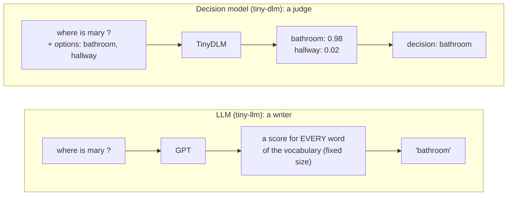
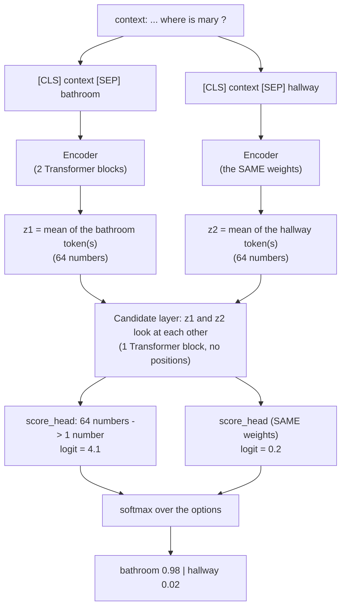
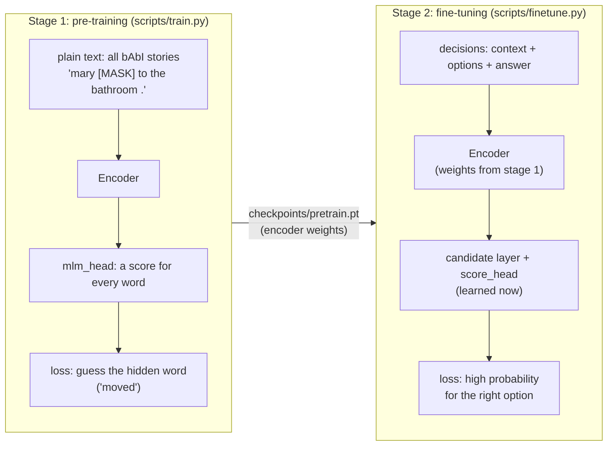
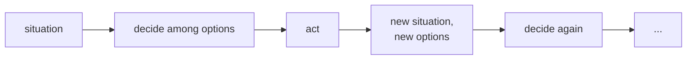

# Tiny DLM FROM SCRATCH

Tiny DLM is a small **decision model** built from scratch in PyTorch, to learn how Jev-style models work.
Every layer is written by hand (no Hugging Face `transformers`), with the same structure as
[tiny-llm](https://github.com/benisalla/tiny-llm): `ModelConfig` / `TrainConfig`, `norm.py`, `rope.py`,
`attention.py`, `mlp.py`, `block.py`, `model.py`, a pre-training script and a fine-tuning script.

**Note:** this is a learning project, not a production system.

## The models

Two little models, named after Greek fruits:

| Name | Reads | Picks |
|---|---|---|
| **Rhoa** (ῥόα, *the pomegranate*): one little fruit full of seeds, like a decision full of options | text | an answer, an intent, a commonsense choice |
| **Mēlon** (μῆλον, *the golden apple*): Paris looked at three goddesses and handed the apple to one | images | how to steer a car |

Both are the same judge (`TinyDLM` and `ImageDLM` in the code; `from tiny_dlm import Rhoa, Melon` also works).

## Documentation

| | Read this to understand |
|---|---|
| [1. Overview](docs/01-overview.md) | LLM vs decision model, input → output, every tensor shape |
| [2. Data](docs/02-data.md) | what the pre-training and fine-tuning data look like, on disk and as tensors |
| [3. Encoder](docs/03-encoder.md) | how one `[CLS] context [SEP] candidate` is read: blocks, bidirectional attention, MLP |
| [4. Decision head](docs/04-decision-head.md) | pooling, candidate layer, score head, softmax over candidates |
| [5. Training](docs/05-training.md) | stage 1 vs stage 2, what each one trains, one fine-tuning step by hand |
| [6. Design variants](docs/06-design-variants.md) | Llama-style vs GPT-2-style layers (RMSNorm/LayerNorm, RoPE/learned, SwiGLU/GELU, GQA, pooling) |

## How a decision model works (step by step, with pictures)

### 1. The one idea: the model is a *judge*, not a *writer*

An LLM is a **writer**: it invents the answer, one word at a time, choosing every word from its whole vocabulary.
A decision model is a **judge**: you hand it the question **and the possible answers**, and it gives each
answer a **score**. The highest score wins.



That is the whole difference. Everything else follows from it.

### 2. Is each decision a special token? **No.**

The options are **plain text**, written with normal words. The model has only 4 special tokens, and none
of them is an option:

| Token | Used for |
|---|---|
| `[PAD]` | filling empty space so sequences have the same length |
| `[CLS]` | the first token of every sequence (with `pool="cls"` its vector is used as the summary, like BERT) |
| `[SEP]` | separates the context from the option |
| `[MASK]` | a hidden word, only in pre-training |

Each option is glued to the context and read as **its own sentence**. Here is a real training example
(the first row of `data/babi/train.csv`):

```
context:    mary moved to the bathroom . john went to the hallway . where is mary ?
candidates: bathroom | hallway
answer:     bathroom
```

The model turns it into **two** sequences, one per option:

```
option 1:  [CLS] mary moved to the bathroom . john went to the hallway . where is mary ? [SEP] bathroom
option 2:  [CLS] mary moved to the bathroom . john went to the hallway . where is mary ? [SEP] hallway
```

Both go through **the same Transformer, with the same weights**. Each one comes out as **one number**.

### 3. The full trip through the model



The steps, with the code that does each one (`tiny_dlm/model.py`, `forward`):

| Step | What happens | Shape (b decisions, k options, s tokens, e = 64 embedding size) |
|---|---|---|
| 0 | build one `[CLS] context [SEP] option` sequence per option | `idx (b, k, s)` |
| 1 | stack all options of all decisions into one big batch | `(b*k, s)` |
| 2 | the encoder reads each sequence, both directions (like BERT) | `(b*k, s, e)` |
| 3 | pool: average the vectors of the option's own tokens (the ones after `[SEP]`): one vector per option | `z (b, k, e)` |
| 4 | candidate layer: the options of one decision attend to each other ("hallway" can see that "bathroom" is also an option) | `(b, k, e)` |
| 5 | `score_head` = `nn.Linear(64, 1)`: each vector becomes one number | `logits (b, k)` |
| 6 | softmax **across the options** | `probs (b, k)`, each row sums to 1 |

### 4. Why it can choose among 2, 3, 6 or 50 options

Look at the shapes of the layers. **No layer has K (the number of options) in it.**

```
wte           (vocab, 64)     words -> vectors           does not know K
encoder       64 -> 64        reads ONE sequence          does not know K
candidate     64 -> 64        attention over a SET        works for any set size
score_head    64 -> 1         ONE vector -> ONE number    does not know K
softmax       any length      turns K numbers into K probabilities
```

Compare it with a classifier:

```
classifier:      vector -> Linear(64, 10) -> 10 numbers          10 is BAKED INTO the weights.
                                                                  It can only ever pick among those 10 classes.

decision model:  option 1 -> Linear(64, 1) -> 1 number  ┐
                 option 2 -> Linear(64, 1) -> 1 number  ├─ the SAME small layer, used K times.
                 ...                                     │  K comes from the INPUT, not from the weights.
                 option K -> Linear(64, 1) -> 1 number  ┘
```

It is like a `for` loop:

```python
scores = [judge(context, option) for option in options]   # works for any len(options)
probs  = softmax(scores)
```

`judge` was trained on decisions with 2 to 6 options, but `judge` itself only ever sees **one option at a
time** (plus the others in the candidate layer, through attention, which also works for any number).
So at test time you can give it 3 options or 10. Two honest limits:

- It can only score options whose **words it knows** (the tokenizer was built from the training text).
- It was trained with at most 6 options. 7 or 10 work mechanically, and usually well, but very large
  option lists (hundreds) were never seen in training, so accuracy can drop. Each option is also one more
  sequence through the encoder, so the cost grows with K.

And the softmax does not care about K either: it takes K numbers and returns K probabilities that sum to 1.

```
K = 2:  logits [4.1, 0.2]             -> probs [0.98, 0.02]
K = 3:  logits [4.1, 0.2, 1.0]        -> probs [0.94, 0.02, 0.04]
K = 5:  logits [4.1, 0.2, 1.0, -1, 0] -> probs [0.92, 0.02, 0.04, 0.01, 0.02]
```

### 5. Training a batch where decisions have different numbers of options

A batch is a box, so it must be rectangular. A decision with fewer options gets **empty slots**, and
`cand_mask` says which slots are real. Empty slots get logit `-inf`, so their probability is exactly 0.

```
                 slot 1      slot 2     slot 3     slot 4
decision 1:      bathroom    hallway    (empty)    (empty)      cand_mask: T T F F
decision 2:      bathroom    hallway    garden     (empty)      cand_mask: T T T F
decision 3:      kitchen     office     garden     hallway      cand_mask: T T T T

logits row 1:    4.1         0.2        -inf       -inf    -> probs 0.98 0.02 0    0
```

### 6. The two training stages



| | Stage 1: pre-training | Stage 2: fine-tuning |
|---|---|---|
| Script | `scripts/train.py` | `scripts/finetune.py` |
| Data | plain text, no answers (6,897 stories, ~594k words, all 20 bAbI tasks) | 9,000 decisions (bAbI task 1) |
| Input | one sentence with ~15% words hidden | `[CLS] context [SEP] option`, one per option |
| Output head | `mlm_head`: a score for every word in the vocabulary | `score_head`: **one** number per option |
| Loss | cross-entropy over the vocabulary at the hidden words | cross-entropy over the **options** |
| What it learns | the language: who moved where, what words mean | to **decide**: which option answers the question |
| Starts from | random weights | the stage 1 weights (`checkpoints/pretrain.pt`) |

The model reads text in both directions (an encoder), so pre-training is **masked-word prediction** like
BERT, not next-word prediction like GPT / tiny-llm. Of the hidden words, 80% become `[MASK]`, 10% a random
word, 10% stay the same.

### 7. What exactly is "fine-tuning"? One training step, by hand

Fine-tuning is **ordinary training**. Nothing magic. The only new things are the **data** (decisions)
and the **loss** (pick the right option). One step on the example above:

```
1. input       context + [bathroom, hallway],   correct answer = bathroom
                                                target = [1.0, 0.0]

2. forward     logits = [0.3, 0.5]          (early in training: almost random)
               probs  = softmax = [0.45, 0.55]  -> the model would pick hallway: wrong

3. loss        loss = -log(prob of the right option) = -log(0.45) = 0.80
               (if the model gave bathroom 0.99, the loss would be -log(0.99) = 0.01)

4. backward    the gradient says: "raise the bathroom logit, lower the hallway logit".
               It flows back through score_head, the candidate layer, AND the encoder,
               so ALL the weights move a little.

5. update      AdamW changes the weights. Next time, this kind of question scores bathroom higher.
```

Repeat for 3,000 batches of 32 decisions, and the model learns the rule "find the last sentence where
that person moved, and pick that place". Nobody writes the rule; the loss pushes the weights toward it.

The code for step 3 (`tiny_dlm/model.py`), which also allows several right answers (targets `0.5, 0.5`):

```python
log_probs = F.log_softmax(logits, dim=-1)          # softmax across the OPTIONS, not the vocabulary
loss = -(targets * log_probs).sum(dim=-1).mean()   # = -log p(right option) when there is one answer
```

**Why pre-train first?** Fine-tuning works from random weights too (`--init_from scratch`). Pre-training
gives the encoder a head start: it already knows the language of the stories, so stage 2 only has to
learn to decide. The Results section compares both.

### 8. "Many decisions" means two different things

1. **Many kinds of decisions with one model.** The context says what is being decided ("where is mary?",
   "which tool should I call?"), and the options can be anything written in words. Train on several kinds
   of decision data and one model learns all of them.
2. **A chain of decisions (an agent).** Decide, act, then build a new context and new options, and decide
   again:



## The model (`tiny_dlm/model.py`)

```
for each candidate i:
    [CLS] context [SEP] candidate_i  ->  wte  ->  EBlock x n_layer (RoPE)  ->  ln_f  ->  mean of the candidate's tokens = z_i
all z_i of one decision              ->  EBlock x n_cand_layer (no positions: candidates are a set)  ->  ln_f
                                     ->  score_head  ->  logit_i  ->  softmax over candidates
pre-training only:                       every token vector  ->  mlm_head (tied to wte)  ->  the hidden word
```

Each `EBlock` is a pre-norm Transformer block like tiny-llm's `DBlock`, but **bidirectional**
(no causal mask) and with a padding mask. Defaults are Llama-style; every choice is a config switch:

| Part | Default (Llama-style) | Switch to GPT-2 style |
|---|---|---|
| positions | RoPE (`pos_encoding="rope"`) | `--pos_encoding learned` |
| norm | RMSNorm, pre-norm | `--norm_type layernorm` |
| MLP | SwiGLU (`gated_mlp=True`, `activation="silu"`) | `--gated_mlp false --activation gelu_tanh` |
| attention | multi-head; grouped-query with `--n_kv_head` | |
| linear layers | no bias | `--bias true` |

Attention uses `F.scaled_dot_product_attention` (flash attention when available). Weights are initialised
like GPT-2 (normal 0.02, scaled residual projections), and the optimizer decays only matrices
(`configure_optimizers`, AdamW, warmup + cosine schedule).

## The data: bAbI (`scripts/prepare_babi.py`)

[bAbI](https://arxiv.org/abs/1502.05698) is an existing, very simple question-answering benchmark from
Facebook AI Research: 20 tasks of short stories with questions. It is turned into training data:

- **Decisions (stage 2):** task 1 ("single supporting fact"), 10k version from
  [facebook/babi_qa](https://huggingface.co/datasets/facebook/babi_qa): 9,000 train / 1,000 val / 1,000 test.
  The candidates are the places mentioned in the story (2 to 6), and the answer is always one of them.
- **Pre-training text (stage 1):** the training stories of all 20 tasks (task 1 from the 10k version,
  tasks 2-20 from the [Muennighoff/babi](https://huggingface.co/datasets/Muennighoff/babi) mirror):
  every sentence and question but no answers. No test story is ever used.

What one example looks like in each stage (more in [2. Data](docs/02-data.md)):

```
STAGE 1 · pre-training · data/babi/pretrain_train.txt (one story per line, no answers)
  file   : mary moved to the bathroom . john went to the hallway . where is mary ?
  input  : [CLS] mary moved to the bathroom [MASK] west went to the hallway . where is mary ?
  target :                                   .     john                           (guess the hidden words)
  tensors: idx (b, s) · targets (b, s), -1 where nothing is hidden

STAGE 2 · fine-tuning · data/babi/train.csv (context, candidates, answers)
  file   : "mary moved to the bathroom . john went to the hallway . where is mary ?", "bathroom | hallway", "bathroom"
  input  : [CLS] mary moved to the bathroom . john went to the hallway . where is mary ? [SEP] bathroom
           [CLS] mary moved to the bathroom . john went to the hallway . where is mary ? [SEP] hallway
  target : bathroom 1.0 · hallway 0.0                                               (pick the right candidate)
  tensors: idx (b, k, s) · cand_mask (b, k) · targets (b, k)
```

## More data: many options, one model (`scripts/prepare_data.py`)

bAbI has only 2 to 6 options. To really test a decision model, three more datasets use the same CSV format:

| Dataset | Options per decision | What is decided | Example | License |
|---|---|---|---|---|
| [CLINC150](https://github.com/clinc/oos-eval) | **151** | the intent of a request (150 + "out of scope") | "how do i say thank you in french" → `translate` | CC BY 3.0 |
| [Banking77](https://github.com/PolyAI-LDN/task-specific-datasets) | **77** | a banking customer's intent | "i am still waiting on my card ?" → `card arrival` | CC BY 4.0 |
| [CommonsenseQA](https://www.tau-nlp.sites.tau.ac.il/commonsenseqa) | 5 | the commonsense answer | "where would you find a seafood restaurant in the east coast ... ?" → `maine` | MIT |

```bash
python scripts/prepare_data.py                                   # download + build data/{clinc150,banking77,csqa,pretrain}
python scripts/train.py --data_dir data/pretrain                 # stage 1 on all the texts (~1M words, no answers)
python scripts/finetune.py --tasks babi,clinc150,banking77,csqa  # stage 2: ONE model, every dataset
```

- **One model, every dataset.** Every decision is "context + options -> pick one", so the datasets mix freely. Each
  batch comes from one dataset, picked in proportion to its size (no bAbI decision padded to 151 options).
- **151 options are expensive**, because each option is its own pass through the encoder. Training keeps the right answer plus
  random wrong options (`--max_train_candidates 16`). Accuracy is always measured with **all** the options.
- **Vocabulary:** words seen at least twice in the pre-training text (`--min_freq 2`), plus every word that appears
  in an option (`data/pretrain/options.txt`), so a possible answer is never `<unk>`.

## Decisions from images: Mēlon drives a car (`tiny_dlm/vision.py`, `tiny_dlm/car.py`)

The same judge, but the context is a **camera image** instead of words. `ImageDLM` cuts the frame into patches
(like a ViT) and reads `[patches] [SEP] option` with the same encoder blocks, candidate layer and score head:

```
48x48 frame -> 36 patches of 8x8 ─┐
                                   ├─ [p1 ... p36] [SEP] steer slight left and accelerate -> EBlocks -> score  ┐
                                   ├─ [p1 ... p36] [SEP] go straight and accelerate       -> EBlocks -> score  ├─ softmax
                                   └─ ... 15 options                                                           ┘
```

The environment is [CarRacing](https://gymnasium.farama.org/environments/box2d/car_racing/) (Gymnasium). The car
wants a continuous action; **"how much left or right" is written in the options**: 7 steering amounts (full / medium /
slight left, straight, slight / medium / full right) x {accelerate, coast} + brake = **15 options**.

- **Teacher:** a pure-pursuit driver that uses the track's waypoints (the model never sees them). Rounded to the 15
  options it scores ~915 (900 = "solved").
- **Data:** the teacher drives 40 tracks. It sometimes steers a notch too far on purpose, but every frame is labelled with
  what the teacher *would* do, so the student learns how to come back to the road (DART, Laskey et al. 2017).
- **Test:** the model drives alone, from pixels, on tracks it never saw (seeds 1000+).

```bash
pip install -e ".[car]"
python scripts/car_record.py          # teacher drives 40 + 5 tracks -> data/car/{train,val}.pt (~35k frames)
python scripts/car_sanity_check.py    # 11 health checks + a picture of the data, before training
python scripts/car_train.py           # -> checkpoints/car.pt
python scripts/car_drive.py --gif docs/assets/car.gif   # drive new tracks: model vs teacher vs straight vs random
```

## Run it

```bash
python3 -m venv .venv
.venv/bin/pip install torch --index-url https://download.pytorch.org/whl/cpu
.venv/bin/pip install -e ".[test]"

.venv/bin/python scripts/prepare_babi.py     # download bAbI, build data/babi/*
.venv/bin/python scripts/train.py            # stage 1 -> checkpoints/pretrain.pt
.venv/bin/python scripts/finetune.py         # stage 2 -> checkpoints/finetune.pt
.venv/bin/python scripts/ask.py --context "Mary moved to the bathroom. John went to the hallway. Where is Mary?" \
                                --candidates "bathroom | hallway"
.venv/bin/python scripts/sanity_check.py     # 12 neural-network sanity checks, ~30 s on CPU
.venv/bin/pytest                             # tests
```

**Training on a GPU (Colab / Kaggle):** open `notebooks/Tiny_DLM(Training).ipynb`. It is self-contained (every class
is in it, no install), downloads bAbI, runs the sanity checks, pre-trains, fine-tunes and reports test accuracy.
Checkpoints go to Google Drive on Colab, `/kaggle/working` on Kaggle. After changing the package, rebuild it with
`python scripts/build_notebook.py`.

Every config field is a flag: `--n_layer 4 --n_embd 128 --max_iters 5000 --learning_rate 3e-4 ...`.

## Results

Not trained to the end yet.

**Sanity checks** (`scripts/sanity_check.py`, on the real bAbI data): 12/12 pass. Initial loss = random guessing
(1.315 vs mean log K 1.320; 4.90 vs log vocab 5.02), every parameter gets a gradient, decisions in a batch do not
leak into each other, shuffling the candidates only shuffles the probabilities, K = 2, 3, 7, 10 all work, and the
model memorises 16 decisions in 35 steps and 8 masked-word examples in 76 steps.

**Pooling matters (a bug found by the sanity checks).** The first version scored each candidate from the `[CLS]`
vector, like BERT. Fine-tuning stayed at random guessing (val loss 1.33 = mean log K), and the sanity check showed
why: with `[CLS]` pooling the model could not even memorise 16 decisions (81% after 300 steps). At the start of
training `[CLS]` looks at all ~70 tokens equally, and the only token that differs between candidates is ~1/70 of
what it sees, so the gradient that would tell candidates apart is tiny. Averaging the candidate's **own** tokens
instead (`pool="candidate"`, now the default) starts each candidate from its own word: 100% after 35 steps.

**Pre-training:** best val loss 0.588 (masked words, from 4.94 at init), with the earlier `[CLS]` version
(pooling has no weights, so this checkpoint is still usable).

## Files

| File | What it does |
|---|---|
| `tiny_dlm/config.py` | `ModelConfig` (architecture) and `TrainConfig` (optimisation) |
| `tiny_dlm/norm.py` | LayerNorm, RMSNorm |
| `tiny_dlm/rope.py` | rotary position embedding |
| `tiny_dlm/attention.py` | bidirectional self-attention with padding mask, multi-head / grouped-query |
| `tiny_dlm/mlp.py` | classic MLP or SwiGLU |
| `tiny_dlm/block.py` | `EBlock`: pre-norm encoder block |
| `tiny_dlm/model.py` | `TinyDLM`: pair encoder, candidate layer, score head, MLM head, `decide()` |
| `tiny_dlm/tokenizer.py` | word-level tokenizer with `[CLS] [SEP] [MASK]` |
| `tiny_dlm/data.py` | decision CSVs and batches, masked-word batches |
| `tiny_dlm/training.py` | lr schedule, training loop, loss estimate, accuracy |
| `tiny_dlm/checkpoint.py` | save / load (with the tokenizer) |
| `scripts/prepare_babi.py` | bAbI -> decisions + pre-training text |
| `scripts/train.py` / `finetune.py` / `ask.py` | stage 1 / stage 2 / ask a question |
| `scripts/sanity_check.py` | 12 fast checks of the data, the network and the pipeline |
| `scripts/build_notebook.py` | builds the Colab / Kaggle notebook from the package code |
| `notebooks/Tiny_DLM(Training).ipynb` | everything in one notebook, to train on a GPU |
| `tests/` | layers, model, data, training pipeline, sanity checks |
