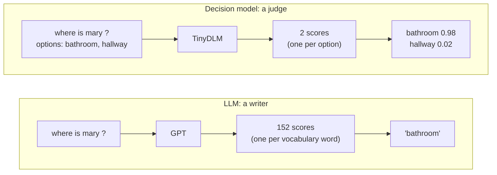
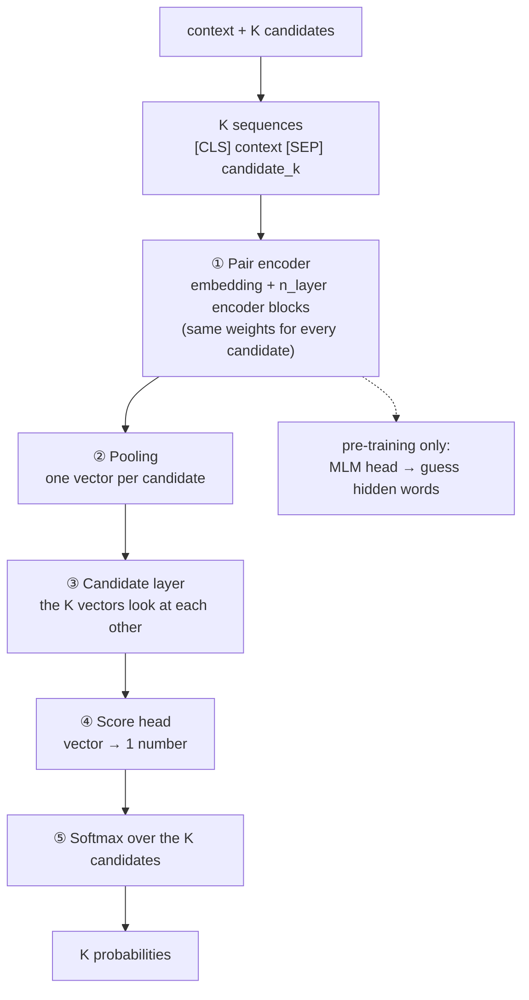

# 1. Overview: what goes in, what comes out

[← back to README](../README.md) · next: [2. Data →](02-data.md)

## LLM vs decision model in one picture

| | LLM (tiny-llm, GPT) | Decision model (tiny-dlm) |
|---|---|---|
| Job | **write** the answer | **choose** the answer from a given list |
| Input | a text | a text **+ a list of options** |
| Output | a probability for every word of the vocabulary | **one probability per option** |
| Size of the output | fixed (vocabulary size) | **as many as the options you give** |
| Reads text | left to right (causal) | in both directions (bidirectional) |
| Can answer something not in the list? | yes (it can also make things up) | **no**, it always picks one of the options |



## The contract: input → output

```
INPUT                                                        OUTPUT
─────                                                        ──────
context:     "mary moved to the bathroom .                   bathroom   0.98   ◀── decision
              john went to the hallway .                     hallway    0.02
              where is mary ?"
candidates:  ["bathroom", "hallway"]        ──▶ TinyDLM ──▶  (one probability per candidate, they sum to 1)
```

- `context`: any text. It says **what** is being decided.
- `candidates`: 1 or more plain-text options. **Not special tokens**, just words.
- Output: one probability per candidate. The decision is the highest one (or a sample, with `temperature > 0`).

## The whole model, from top to bottom



| Part | What it does | Details |
|---|---|---|
| ① Pair encoder | reads one `[CLS] context [SEP] candidate` sequence, both directions | [3. Encoder](03-encoder.md) |
| ② Pooling | turns the sequence into **one** vector for this candidate | [4. Decision head](04-decision-head.md) |
| ③ Candidate layer | lets the candidates of one decision compare themselves | [4. Decision head](04-decision-head.md) |
| ④ Score head | `Linear(n_embd, 1)`: one vector → one score | [4. Decision head](04-decision-head.md) |
| ⑤ Softmax | turns K scores into K probabilities | [4. Decision head](04-decision-head.md) |
| MLM head | pre-training only: guesses the hidden words | [5. Training](05-training.md) |

## Tensor shapes, step by step

With the default config (`n_embd = 64`) and a batch of **B** decisions, **K** candidates (the largest in the
batch), **T** tokens (the longest sequence in the batch):

```
idx         (b, k, s)        token ids                         e.g. (32, 6, 71)
   │  reshape: every candidate becomes its own row
   ▼
            (b·k, s)                                            (192, 71)
   │  ① encoder
   ▼
            (b·k, s, e)     one vector per token               (192, 71, 64)
   │  ② pooling
   ▼
z           (b, k, e)       one vector per candidate           (32, 6, 64)
   │  ③ candidate layer
   ▼
            (b, k, e)                                          (32, 6, 64)
   │  ④ score head
   ▼
logits      (b, k)           one number per candidate           (32, 6)
   │  ⑤ softmax over K (empty slots get -inf → probability 0)
   ▼
probs       (b, k)           each row sums to 1                 (32, 6)
```

## Why the number of options is free

Look at the weights: **none of them has K in its shape.**

```
wte          (vocab, 64)    word → vector
encoder      64 → 64        reads ONE sequence
candidate    64 → 64        attention over a set (any size)
score_head   64 → 1         ONE vector → ONE number
```

So the model is used like a loop over the options:

```python
scores = [judge(context, option) for option in options]   # any number of options
probs  = softmax(scores)
```

It was trained with 2 to 6 options, and it works with 3, 7 or 10 (checked by `scripts/sanity_check.py`).
Limits: it only knows the words it saw in training, and the cost grows with K (one sequence per option).

## The files

| File | Part |
|---|---|
| `tiny_dlm/model.py` | `TinyDLM`: ① → ⑤ and the MLM head |
| `tiny_dlm/block.py` | `EBlock`: one encoder block |
| `tiny_dlm/attention.py` | `SelfAttention` |
| `tiny_dlm/mlp.py` | `MLP` (classic or SwiGLU) |
| `tiny_dlm/norm.py` | `LayerNorm`, `RMSNorm` |
| `tiny_dlm/rope.py` | `RotaryEmbedding` |
| `tiny_dlm/config.py` | `ModelConfig`, `TrainConfig` |
