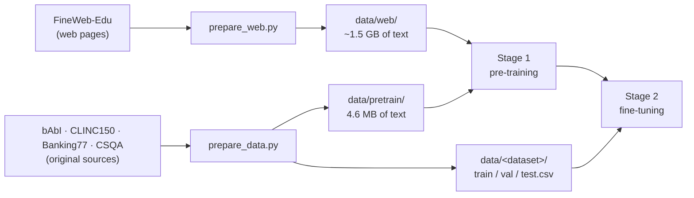

# 2. Data: what the model reads in each stage

[← 1. Overview](01-overview.md) · next: [3. Encoder →](03-encoder.md)

Rhoa learns in two stages, from two different kinds of data:

| Stage | What it learns | Data | Has answers? |
|---|---|---|---|
| 1. pre-training | the language: which words go together | plain text, one of two corpora (below) | no |
| 2. fine-tuning | to choose: the right option for a question | 4 decision datasets, as CSV | yes |



---

## Stage 1: pre-training data

There are two pre-training corpora, kept side by side so we can compare what each one gives the model.
`scripts/train.py --data_dir data/pretrain` or `--data_dir data/web` picks one.

### Corpus A: `data/pretrain/`, small and close to the tasks (4.6 MB)

Built by `scripts/prepare_data.py`. One text per line, **never an answer**, and never a validation or test question.

| Part | Lines | Example line |
|---|---|---|
| bAbI stories (all 20 bAbI tasks) | 6,897 | `mary moved to the bathroom . john went to the hallway . daniel went back to the hallway . …` |
| CLINC150 training questions | 15,100 | `i want to find out how do i schedule a meeting` |
| Banking77 training questions | 9,003 | `why has my transfer not arrived yet ?` |
| CommonsenseQA training questions | 8,658 | `where would you stand in a line and not need a coat if it is cold outside ?` |
| **Total** | **39,658** | about 960,000 words (`pretrain_train.txt`), plus `pretrain_val.txt` (5,424 lines) |

`options.txt` lists every option text (13,141). The tokenizer learns from them too, so every possible answer is
written well.

What this corpus teaches: the words and sentence shapes of our four tasks. What it cannot teach: anything about the
world beyond them (that is why every model fails CommonsenseQA; see the README).

### Corpus B: `data/web/`, big and general (~1.5 GB)

Built by `scripts/prepare_web.py` from [FineWeb-Edu](https://huggingface.co/datasets/HuggingFaceFW/fineweb-edu):
educational web pages filtered from Common Crawl, the data that small open models such as SmolLM learn from.
It has nothing to do with our four tasks, which is the point: like a real language model, Rhoa first reads
general text, then learns the tasks.

| File | Content |
|---|---|
| `train.txt`, `val.txt` | one web page per line (val: every 200th page, never trained on) |
| `tokenizer.json` | the BPE tokenizer (8,192 tokens) learned on the first 200 MB of `train.txt` |
| `train.bin`, `val.bin` | every page as token ids (uint16), pages separated by `<sep>` |
| `stats.json` | how many pages, bytes and tokens |

Size: 1.50 GB of text, 358.7 million tokens to train on (1.9 million more for validation).
The first words of three lines of `train.txt` (each line is a whole page, often thousands of words):

```
Taking Play Seriously By ROBIN MARANTZ HENIG Published: February 17, 2008 On a drizzly Tuesday night in late January, …
Bolivia: Coca-chewing protest outside US embassy Indigenous activists in Bolivia have been holding a mass coca-chewing …
RWJF Priority: Use pricing strategies—both incentives and disincentives—to promote the purchase of healthier foods …
```

The text is lowercased by the tokenizer, like the fine-tuning data. With the web tokenizer:

```
the heart pumps blood through the body   →    the| heart| p|umps| blood| through| the| body
```

### From text to one training example (both corpora)

The model gets about 15% of the tokens hidden and must guess them, looking at the words on **both sides**
(BERT's "masked language modelling"):

```
text      mary moved to the bathroom . john went to the hallway . where is mary ?
tokens    <cls>| mary| moved| to| the| bathroom| .| john| went| to| the| hallway| .| where| is| mary| ?
input     <cls>|<mask>| moved| to| the| bathroom| .| john| went| to| the| hallway| .| where|<mask>| mary| ?
targets            mary                                         to   the                  is
```

- Of the hidden tokens, 80% become `<mask>`, 10% a random token and 10% stay the same, so the model must check
  every token, not only the masked ones (here `to` and `the` are hidden but left unchanged).
- The tokens to hide are drawn again every time a text is used ("dynamic masking", as in RoBERTa).
- The targets hold the hidden token where one was hidden and `-1` everywhere else; the loss only looks at those.
- Corpus A: each line is one example (cut to 128 tokens). Corpus B: an example is a random 127-token window of
  `train.bin`, after `<cls>`, so it may span the end of one page and the start of the next (marked by `<sep>`).

A batch is a table of token ids, one row per example: 64 examples of 128 tokens make a 64 × 128 table for the input
and the same for the targets.

---

## Stage 2: fine-tuning data (decisions)

Built by `scripts/prepare_data.py`. Every dataset has the same shape, `data/<dataset>/{train,val,test}.csv`, with
three columns: the context, the options separated by `|`, and the right answer(s).

| Dataset | Question | Options | Train / val / test |
|---|---|---|---|
| bAbI (task 1) | where is someone, after a short story? | 2–6 places | 9,000 / 1,000 / 1,000 |
| CLINC150 | which of 150 assistant intents (or "out of scope")? | 151 | 15,100 / 3,100 / 5,500 |
| Banking77 | which of 77 banking intents? | 77 | 9,003 / 1,000 / 3,080 |
| CommonsenseQA | everyday-knowledge question | 5 | 8,658 / 961 / 1,197 |

One real row of each (options shortened):

```
babi       context     mary moved to the bathroom . john went to the hallway . … john moved to the office . … where is john ?
           candidates  bathroom | hallway | garden | office
           answers     office

clinc150   context     tell me how to say 'it is a beautiful morning' in italian
           candidates  accept reservations | account blocked | alarm | application status | apr | …   (151)
           answers     translate

banking77  context     why did i get charged a fee i thought it was free ?
           candidates  activate my card | age limit | apple pay or google pay | atm support | …   (77)
           answers     cash withdrawal charge

csqa       context     where would you stand in a line and not need a coat if it is cold outside ?
           candidates  good book | bus stop | post office | triangle | graph
           answers     post office
```

### From a row to what the model sees

Each option gets its own copy of the question: `<cls> question <sep> option`. The model reads each copy and gives
it one score; the scores of a question's options go through a softmax, and the right option should win.

The CommonsenseQA row above, with the BPE tokenizer (5 options, 23 tokens each after padding):

```
<cls>| where| would| you| stand| in| a| line| and| not| need| a| co|at| if| it| is| cold| outside| ?|<sep>| good| book
<cls>| where| would| you| stand| in| a| line| and| not| need| a| co|at| if| it| is| cold| outside| ?|<sep>| bus| stop
<cls>| where| would| you| stand| in| a| line| and| not| need| a| co|at| if| it| is| cold| outside| ?|<sep>| post| office   ← right
<cls>| where| would| you| stand| in| a| line| and| not| need| a| co|at| if| it| is| cold| outside| ?|<sep>| triangle|<pad>
<cls>| where| would| you| stand| in| a| line| and| not| need| a| co|at| if| it| is| cold| outside| ?|<sep>| gra|ph

cand_mask   [True, True, True, True, True]      which option slots are real
targets     [0, 0, 1, 0, 0]                      the right answer (split equally if several are right)
```

- A batch holds several questions. They can have different numbers of options: the batch is padded to the largest,
  and `cand_mask` marks the empty slots so they never get any probability.
- Training keeps the right answer plus random wrong ones, at most 16 options per question
  (`--max_train_candidates`): CLINC150's 151 options would be 10x slower. Accuracy is always measured with
  **all** the options.
- `--tasks babi,clinc150,banking77,csqa` trains one model on all four: each batch comes from one dataset, picked in
  proportion to its size.

---

## Tokens: two tokenizers

The same sentence, cut by each tokenizer (`tiny_dlm/tokenizer.py`, details in the README):

```
WTokenizer    what's|the|usual|time|to|get|a|new|card|when|your|previous|one|was|lost
BPETokenizer  what|'|s| the| us|ual| time| to| get| a| new| card| when| your| previous| one| was| lost
```

- `WTokenizer`: one token per whole word. Simple, but a word it never saw becomes `<unk>`.
- `BPETokenizer`: pieces of words learned from the text (byte pair encoding). Common words are one token, rare ones
  are built from pieces (`" us" + "ual"`), and nothing is ever unknown. Each text starts with a space, so a word is
  the same token at the start of a text and in the middle.

## Side by side

| | Stage 1: pre-training | Stage 2: fine-tuning |
|---|---|---|
| Files | `data/pretrain/pretrain_*.txt` or `data/web/*.bin` | `data/<dataset>/{train,val,test}.csv` |
| One example | a piece of text with hidden tokens | a question with all its options |
| Has answers? | no | yes |
| The model outputs | a guess over the whole vocabulary at each hidden token | one score per option |
| Built by | `make_chunks`, `get_stream_batch`, `mask_tokens` | `load_csv`, `collate` |
