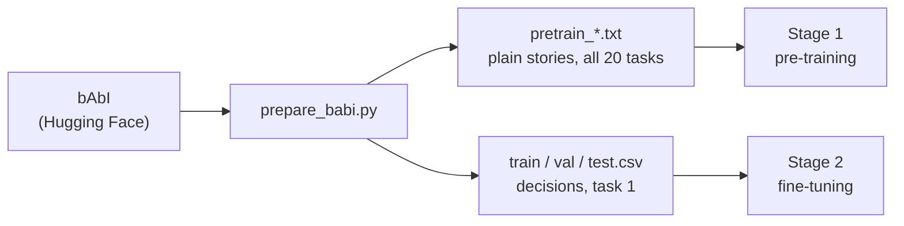

# 2. Data: what the model eats in each stage

[← 1. Overview](01-overview.md) · next: [3. Encoder →](03-encoder.md)

Both stages use [bAbI](https://arxiv.org/abs/1502.05698), a very simple question-answering benchmark made of short
stories. `scripts/prepare_babi.py` downloads it and writes everything into `data/babi/`:

| File | Stage | Content | Size |
|---|---|---|---|
| `pretrain_train.txt` | 1. pre-training | one story per line, **no answers** | 6,897 stories, ~594k words |
| `pretrain_val.txt` | 1. pre-training | the same, held out (every 20th story) | 363 stories |
| `train.csv` | 2. fine-tuning | one decision per row | 9,000 |
| `val.csv` | 2. fine-tuning | one decision per row | 1,000 |
| `test.csv` | 2. fine-tuning | one decision per row, used only at the very end | 1,000 |



---

## Stage 1: pre-training data (plain text)

### On disk: one story per line

```
mary went to the bedroom . john journeyed to the bathroom . where is john ? sandra journeyed to the hallway . ...
mary journeyed to the bedroom . fred moved to the bedroom . fred went to the bathroom . jeff went back to the office . ...
```

Stories of all 20 bAbI tasks (training split only), every sentence and every question, **never the answer**.
Nothing here says what the right answer is: this stage only teaches the language.

### In the model: hide ~15% of the words, ask the model to guess them

A real example (`mask_tokens` in `tiny_dlm/data.py`):

```
original : [CLS] mary moved to the bathroom  .      john  went to the hallway . where is mary ?
input    : [CLS] mary moved to the bathroom [MASK]  west  went to the hallway . where is mary ?
target   :   -    -     -   -   -     -       .     john   -    -   -     -    -   -    -   -   -
                                              ▲      ▲
                                    hidden with [MASK]   replaced by a random word
```

Of the picked words, 80% become `[MASK]`, 10% a random word (here `john` → `west`), and 10% stay the same.
`-` means "not part of the loss". The model must use the words **on both sides** to guess.

### As tensors

```
idx      (b, s)   long   [2, 88, 93, 131, 124, 18, 4, 138, 137, 131, 124, 67, 5, 140, 74, 88, 6]
targets  (b, s)   long   [-1, -1, -1, -1, -1, -1, 5, 78, -1, -1, -1, -1, -1, -1, -1, -1, -1]
                                                  ▲   ▲
                                                 "."  "john"   (-1 = ignored by the loss)
```

Long stories are cut into chunks of at most `block_size` tokens, each starting with `[CLS]`.

---

## Stage 2: fine-tuning data (decisions)

### On disk: a CSV with 3 columns

| context | candidates | answers |
|---|---|---|
| `mary moved to the bathroom . john went to the hallway . where is mary ?` | `bathroom \| hallway` | `bathroom` |
| `mary moved to the bathroom . john went to the hallway . daniel went back to the hallway . sandra moved to the garden . where is daniel ?` | `bathroom \| hallway \| garden` | `hallway` |

- **context**: the story so far + the question.
- **candidates**: the possible answers, separated by `|`. Here, the places mentioned in the story (2 to 6).
- **answers**: the right one(s). Always one of the candidates. Several are allowed (`a | b`): each gets an equal share.

How many candidates the 9,000 training decisions have:

```
2 options  ██████████████▋              1,761
3 options  ██████████▉                  1,318
4 options  ███████████████████▏         2,303
5 options  ███████████████████▎         2,314
6 options  ██████████▊                  1,304
```

### In the model: one sequence per candidate

The second row above becomes **3** sequences, one per candidate. Only the last word changes:

```
[CLS] mary moved to the bathroom . john went ... where is daniel ? [SEP] bathroom
[CLS] mary moved to the bathroom . john went ... where is daniel ? [SEP] hallway     ◀── right answer
[CLS] mary moved to the bathroom . john went ... where is daniel ? [SEP] garden
```

### As tensors: a batch of 2 decisions (2 and 3 candidates)

```
idx        (B=2, K=3, T=32)  long    token ids; decision 1's 3rd slot is empty (a lone [CLS])

cand_mask  (B=2, K=3)        bool    [[True, True, False],     ◀── decision 1 has only 2 candidates
                                      [True, True, True ]]

targets    (B=2, K=3)        float   [[1.0, 0.0, 0.0],         ◀── bathroom is right
                                      [0.0, 1.0, 0.0]]         ◀── hallway is right
```

- **K** = the most candidates in the batch. Shorter decisions get empty slots, which `cand_mask` hides.
- **T** = the longest sequence in the batch. Shorter sequences are padded with `[PAD]`, which attention ignores.
- **targets** sum to 1 per decision. With two right answers they would be `0.5, 0.5`.

---

## The vocabulary

One word-level tokenizer for both stages, built from the training text (`tiny_dlm/tokenizer.py`): **152 tokens**.

```
id    0       1       2       3       4        5   6   7   8       ...
     <pad>   <unk>   <cls>   <sep>   <mask>    .   ?   a   above   ...
```

Text is lowercased and split into words, `.` and `?` (sentence ends matter: the **last** sentence about a person
is the one that answers "where is ...?"). A word never seen in training becomes `<unk>`.

## Side by side

| | Stage 1: pre-training | Stage 2: fine-tuning |
|---|---|---|
| File | `pretrain_*.txt` | `train/val/test.csv` |
| One example | one story chunk | one decision (context + K candidates) |
| Has answers? | no | yes |
| Input tensor | `idx (b, s)` with some `[MASK]` | `idx (b, k, s)`, one row per candidate |
| Target tensor | `targets (b, s)`: the hidden word, `-1` elsewhere | `targets (b, k)`: probability of each candidate |
| Extra | | `cand_mask (b, k)`: which slots are real |
| Built by | `make_chunks`, `mask_tokens` | `load_csv`, `collate` |
