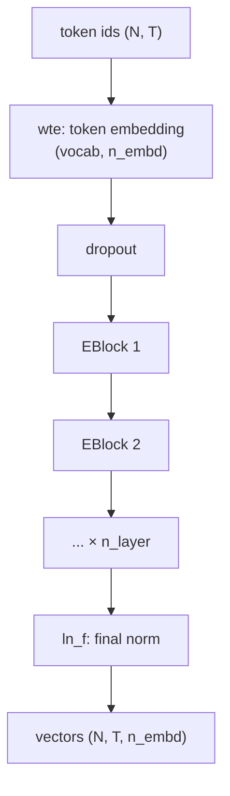
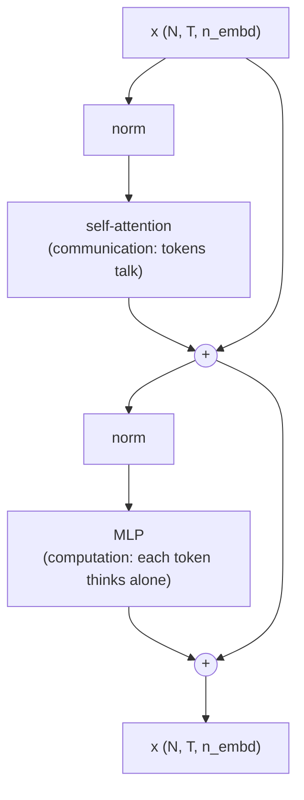

# 3. The pair encoder: reading one `[CLS] context [SEP] candidate`

[← 2. Data](02-data.md) · next: [4. Decision head →](04-decision-head.md)

The encoder is the "reading" part. It is a stack of Transformer blocks, like GPT, with one big difference:
**every word can look at every other word, before and after it** (bidirectional), like BERT.

```
INPUT   idx   (N, T)          token ids        N = number of sequences, T = tokens
OUTPUT  h     (N, T, n_embd)  one vector per token, which now "knows" about the whole sequence
```

## Inside



There is no position vector added at the input: positions come from **RoPE**, inside attention
(see [6. Design variants](06-design-variants.md) to switch to GPT-2's learned positions).

## One encoder block (`EBlock`, `tiny_dlm/block.py`)

Pre-norm, like GPT-2 and every model after it. Two steps, each with a shortcut (residual):



```python
x = x + attn(norm_1(x), keep)    # tokens exchange information
x = x + mlp(norm_2(x))           # each token processes what it gathered
```

## Self-attention: causal (GPT) vs bidirectional (here)

Who can look at whom, for the sequence `[CLS] mary went . [SEP] office [PAD]` (✓ = allowed):

```
GPT / tiny-llm (causal)                         TinyDLM (bidirectional + padding mask)
             CLS mary went  .  SEP office PAD                CLS mary went  .  SEP office PAD
  CLS         ✓                                    CLS        ✓    ✓    ✓   ✓   ✓    ✓
  mary        ✓    ✓                               mary       ✓    ✓    ✓   ✓   ✓    ✓
  went        ✓    ✓    ✓                          went       ✓    ✓    ✓   ✓   ✓    ✓
  .           ✓    ✓    ✓   ✓                      .          ✓    ✓    ✓   ✓   ✓    ✓
  SEP         ✓    ✓    ✓   ✓   ✓                  SEP        ✓    ✓    ✓   ✓   ✓    ✓
  office      ✓    ✓    ✓   ✓   ✓    ✓             office     ✓    ✓    ✓   ✓   ✓    ✓
                                                   PAD        ✓    ✓    ✓   ✓   ✓    ✓    (never looked at)
```

- **Why bidirectional?** The model generates nothing, it reads a finished input. The candidate word `office`
  at the end must be able to look back at the whole story, and the story words can look at the candidate.
- **Padding mask (`keep`)**: `[PAD]` tokens only exist to make sequences the same length. Nobody attends to them,
  so padding never changes the result (checked by `scripts/sanity_check.py`, check 6).

The attention itself (`tiny_dlm/attention.py`):

```
x (N, T, n_embd) ──c_attn──▶ q, k, v ──split into n_head heads──▶ (N, n_head, T, head_dim)
                              │
                     RoPE rotates q and k (position information)
                              │
          softmax(q · kᵀ / √head_dim  + mask) · v        ◀── F.scaled_dot_product_attention
                              │
               heads put back together ──c_proj──▶ (N, T, n_embd)
```

## MLP

Applied to each token on its own. The default is **SwiGLU** (Llama): a gate decides how much of each feature passes.

```
classic (GPT-2):   x ──c_fc──▶ GELU ──c_proj──▶ out
SwiGLU (default):  x ──c_gate──▶ SiLU ─┐
                   x ──c_fc────────────×──c_proj──▶ out
```

Hidden size: `4 × n_embd` (256 with the defaults).

## Default sizes

| Setting | Value | Meaning |
|---|---|---|
| `n_layer` | 2 | encoder blocks |
| `n_embd` | 64 | size of every token vector |
| `n_head` | 4 | attention heads (16 dimensions each) |
| `block_size` | 128 | longest sequence (bAbI task 1 needs 75) |
| `drop_rate` | 0.1 | dropout |

The encoder is the **only** part used by both stages: pre-training trains it to understand the stories, and
fine-tuning starts from those weights.
