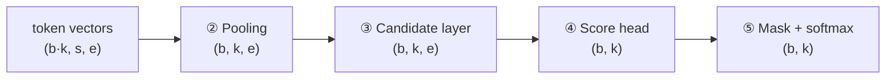
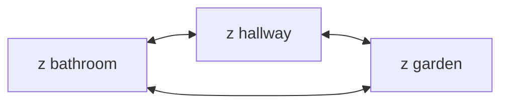

# 4. The decision head: from token vectors to one probability per candidate

[← 3. Encoder](03-encoder.md) · next: [5. Training →](05-training.md)

After the encoder, each candidate is a sequence of token vectors. The decision head turns them into
**one probability per candidate**, in four steps:



## ② Pooling: one vector per candidate

A sequence has T vectors; we need **one**. Two options (`pool` in `ModelConfig`):

```
                 [CLS] mary moved to the bathroom . ... where is mary ? [SEP] bathroom
encoder output:   h0    h1   h2   h3  h4   h5     h6     ...            hSEP   h_bath

pool="cls"        z = h0                                   (the first vector, like BERT)
pool="candidate"  z = mean(h_bath)                         (the candidate's own tokens)   ◀── default
```

A multi-word candidate (`"take an umbrella"`) gets the **average** of its words' vectors.

### Why `candidate` is the default (a real bug, found by the sanity checks)

```
pool="cls":        [CLS] looks at ~70 tokens. The ONLY token that differs between candidates is the last one.
                   At the start of training it is ~1/70 of what [CLS] sees
                   → the candidates look almost the same → stuck at random guessing.

pool="candidate":  the candidate vector STARTS from its own word ("bathroom" ≠ "hallway"),
                   then gathers from the story what is known about that place.
```

| Sanity check: memorise 16 decisions | Result |
|---|---|
| `pool="cls"` | 81% correct after 300 steps (loss 0.44) |
| `pool="candidate"` | **100% correct after 35 steps** (loss 0.05) |

`cls` still works with a lot of pre-training (that is what BERT does), so it is kept as an option.

## ③ Candidate layer: the options compare themselves

Until now each candidate was read **alone**. This layer lets the candidates of the same decision attend to each other,
so a score can depend on the other options ("bathroom looks good, but is there something better?").



- It is the same `EBlock` as in the encoder (`n_cand_layer = 1` by default), but on **K vectors** instead of T tokens.
- **No positions**: the candidates are a set, not a sequence. Shuffling them only shuffles the scores
  (sanity check 7).
- `cand_mask` hides the empty slots, so a decision with 2 candidates in a batch of K = 6 is not affected.

## ④ Score head: one vector → one number

```python
score_head = nn.Linear(n_embd, 1)        # 64 numbers → 1 number
```

The **same** small layer is applied to every candidate. This is why the number of candidates is free:

```
classifier:      vector ──Linear(64, 10)──▶ 10 scores        the 10 is inside the weights: fixed forever

decision model:  z_1 ──Linear(64, 1)──▶ score_1  ┐
                 z_2 ──Linear(64, 1)──▶ score_2  ├─ K comes from the input, not from the weights
                 z_K ──Linear(64, 1)──▶ score_K  ┘
```

## ⑤ Mask + softmax over the candidates

```
               slot 1      slot 2     slot 3     slot 4
candidates:    bathroom    hallway    (empty)    (empty)
cand_mask:     True        True       False      False
logits:        4.1         0.2        -inf       -inf        ◀── empty slots get -inf
probs:         0.98        0.02       0.00       0.00        ◀── softmax: exp(-inf) = 0
```

The softmax works for any K:

```
K = 2:  logits [4.1, 0.2]                  → probs [0.98, 0.02]
K = 3:  logits [4.1, 0.2, 1.0]             → probs [0.94, 0.02, 0.04]
K = 5:  logits [4.1, 0.2, 1.0, -1.0, 0.0]  → probs [0.92, 0.02, 0.04, 0.01, 0.02]
```

## Deciding (`model.decide`)

```
temperature = 0   → take the highest probability             (default, deterministic)
temperature > 0   → sample from softmax(logits / temperature)  (explore, e.g. for an agent)
```

Empty slots can never be picked, at any temperature.
