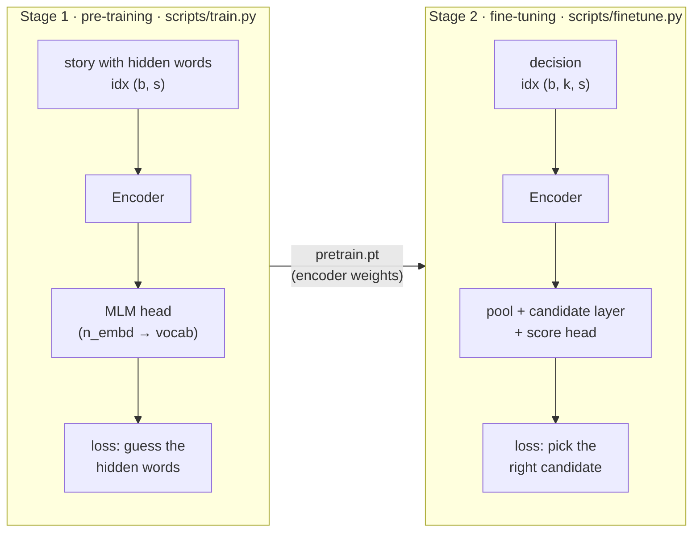

# 5. Training: pre-training, then fine-tuning

[← 4. Decision head](04-decision-head.md) · next: [6. Design variants →](06-design-variants.md)

One model, two stages. They share the encoder; each stage has its own head and its own loss.



## Which parts each stage trains

```
                         Stage 1: pre-training      Stage 2: fine-tuning
wte (word embeddings)    ██ trained                 ██ trained (starts from stage 1)
encoder blocks           ██ trained                 ██ trained (starts from stage 1)
mlm_head                 ██ trained (tied to wte)   ·· not used
candidate layer          ·· not used                ██ trained (starts random)
score_head               ·· not used                ██ trained (starts random)
```

`mlm_head` shares its weights with `wte` (weight tying, like tiny-llm's `lm_head`).

## Stage 1: pre-training (learn the language)

```
input   [CLS] mary moved to the bathroom [MASK] west went to the hallway . where is mary ?
output  for every position: a score for each of the 152 words
loss    cross-entropy at the hidden positions only:   -log p(".")  and  -log p("john")
```

| | |
|---|---|
| Data | `pretrain_train.txt` (stories, no answers) |
| Loss at the start | ≈ log(152) = 5.02 (random guessing over the vocabulary) |
| What it learns | the stories' language: who, moved, where, sentence order |
| Output | `checkpoints/pretrain.pt` (best validation loss) |

## Stage 2: fine-tuning (learn to decide)

Fine-tuning is **ordinary training** with new data and a new loss. One step, by hand:

```
1. input       context + [bathroom, hallway]            right answer: bathroom → target [1.0, 0.0]

2. forward     logits [0.3, 0.5]  →  softmax  →  probs [0.45, 0.55]        (would pick hallway: wrong)

3. loss        -log p(bathroom) = -log(0.45) = 0.80
               (perfect: -log(0.99) = 0.01)

4. backward    gradient: "raise bathroom's score, lower hallway's"
               flows through score_head → candidate layer → pooling → encoder → wte

5. update      AdamW moves every weight a little. Repeat for thousands of batches.
```

The loss in code (`tiny_dlm/model.py`), which also handles several right answers (targets `0.5, 0.5`):

```python
log_probs = F.log_softmax(logits, dim=-1)          # softmax over the CANDIDATES, not the vocabulary
loss = -(targets * log_probs).sum(dim=-1).mean()   # = -log p(right candidate) with one answer
```

| | |
|---|---|
| Data | `train.csv` (9,000 decisions), `val.csv` to pick the best checkpoint, `test.csv` only at the end |
| Loss at the start | ≈ mean(log K) = 1.32 (random guessing among the candidates) |
| What it learns | "find the last sentence about that person, pick that place" (nobody writes this rule) |
| Output | `checkpoints/finetune.pt` + train / val / test accuracy |
| Compare | `--init_from scratch` fine-tunes without stage 1, to see what pre-training brings |

## The optimisation loop (both stages)

Same loop as tiny-llm (`tiny_dlm/training.py`):

```
for each step:
    lr = warmup (linear) → cosine decay → min_lr
    every eval_interval steps: estimate train / val loss, save the checkpoint if val loss improved
    forward → loss → backward → clip gradients (1.0) → AdamW step
```

```
lr
 │    ╭──────╮
 │   ╱        ╲___
 │  ╱             ╲____
 │ ╱                   ╲________   min_lr
 └──────────────────────────────── step
   warmup   cosine decay
```

AdamW decays only the matrices (weights, embeddings), not the biases and norms.

## Before a long run: the sanity checks

`python scripts/sanity_check.py` (about 30 s on CPU) checks that the network **can** learn before you spend GPU
hours. It checks the data, that the loss at init equals random guessing, that every weight gets a gradient, that
padding and batch neighbours change nothing, that any number of candidates works, that the model can memorise a
small batch in both stages, and that save → load gives the same outputs. The notebook runs the most important ones
before training.

## Where to train

| Where | How |
|---|---|
| GPU (Colab / Kaggle) | `notebooks/Tiny_DLM(Training).ipynb`: everything in one notebook, mixed precision |
| Local | `scripts/train.py` then `scripts/finetune.py` (slow on CPU) |
