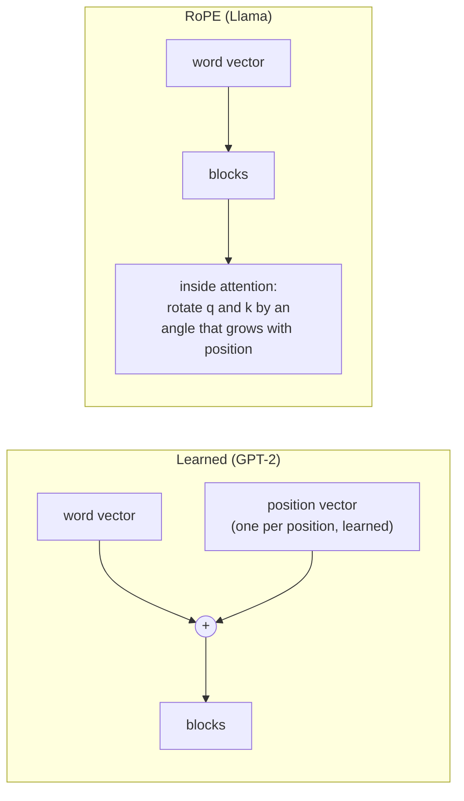
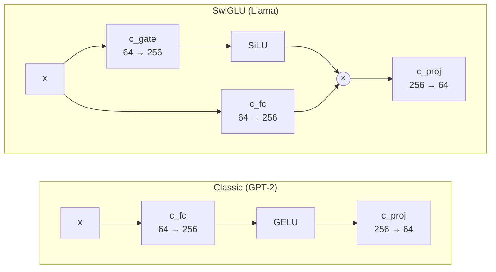

# 6. Design variants: Llama-style vs GPT-2-style

[← 5. Training](05-training.md) · [back to README](../README.md)

Every layer has two versions: the modern one used by Llama / Qwen2 (the default), and the older GPT-2 one.
Each choice is one config switch, so you can compare them on the same data.

| Part | Default (Llama-style) | GPT-2 style | Flag |
|---|---|---|---|
| Normalisation | RMSNorm | LayerNorm | `--norm_type layernorm` |
| Positions | RoPE (rotary) | learned position embeddings | `--pos_encoding learned` |
| MLP | SwiGLU (gated, SiLU) | classic (GELU) | `--gated_mlp false --activation gelu_tanh` |
| Attention | multi-head | (same) | grouped-query: `--n_kv_head 2` |
| Linear layers | no bias | bias | `--bias true` |
| Pooling | candidate tokens | `[CLS]` (BERT) | `--pool cls` |

```bash
# full GPT-2 / BERT style
python scripts/finetune.py --init_from scratch --norm_type layernorm --pos_encoding learned \
       --gated_mlp false --activation gelu_tanh --bias true --pool cls
```

---

## Normalisation: LayerNorm vs RMSNorm

Both keep the numbers in each vector at a stable size, so deep networks train well.

```
LayerNorm (GPT-2, BERT):   y = (x - mean(x)) / std(x) · weight + bias       centre, then scale
RMSNorm   (Llama, Qwen2):  y = x / rms(x) · weight                         scale only (cheaper)
```

```
x          [ 2.0,  4.0,  6.0]
LayerNorm  [-1.22, 0.00, 1.22]     mean removed, std = 1
RMSNorm    [ 0.46, 0.93, 1.39]     direction kept, rms = 1
```

## Positions: learned vs RoPE

Attention alone does not know word order. Both versions add it, in different places.



- **Learned**: position 7 always gets the same added vector. The model must learn what "position 7" means.
- **RoPE**: Q and K are rotated by the angle `theta[m, i] = m / base^(2i/h)`; the score `Q · K` then depends only on the **distance** between two words.
  "The word 3 positions before me" means the same thing anywhere in the story. No extra weights.

## MLP: classic vs SwiGLU



SwiGLU has a **gate**: one branch decides, feature by feature, how much of the other branch passes. It has one more
matrix (3 instead of 2) and usually trains better for the same compute.

## Attention: multi-head vs grouped-query

```
multi-head (n_kv_head = n_head = 4)        grouped-query (n_kv_head = 2)
  q1 q2 q3 q4                                q1 q2   q3 q4
  k1 k2 k3 k4                                 k1       k2         ◀── 2 query heads share one k/v head
  v1 v2 v3 v4                                 v1       v2
```

Grouped-query attention (Llama 2/3, Qwen2) stores fewer keys and values: less memory, almost the same quality.
`n_head` must be a multiple of `n_kv_head`.

## Pooling: `[CLS]` vs candidate tokens

Covered in [4. Decision head](04-decision-head.md#-pooling-one-vector-per-candidate): `candidate` starts each
candidate from its own word and learns much faster on small models; `cls` is the BERT way and needs more pre-training.

## Not a switch: what is always the same

- **Pre-norm** blocks (norm before attention and MLP), like GPT-2 and Llama.
- **Bidirectional** attention with a padding mask (an encoder, not a decoder).
- **Weight tying** between `wte` and `mlm_head`.
- **GPT-2 initialisation**: normal(0, 0.02), residual projections scaled by `1 / sqrt(2 · n_layers)`.
- `F.scaled_dot_product_attention` (flash attention when available).
