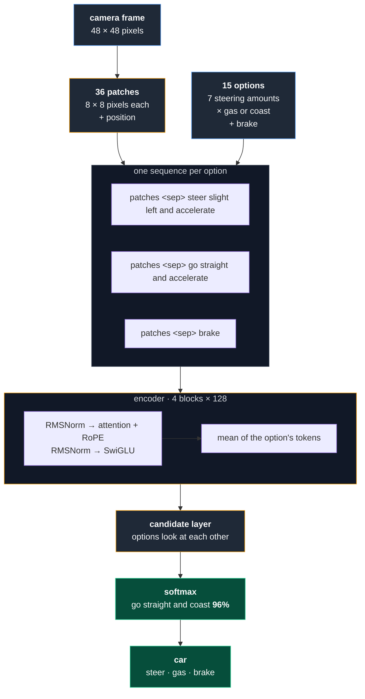
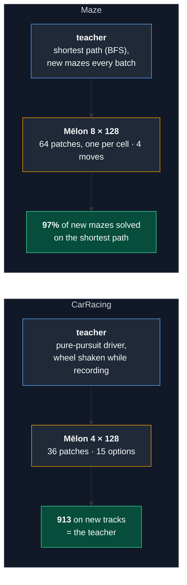

# Mēlon · the model that sees

[← README](../README.md) · [← Rhoa](rhoa.md) · [Data](02-data.md)

Mēlon is the same judge as Rhoa, with a picture instead of a question. It cuts the image into small squares,
reads them with the option's words, and gives every option a score.

## Two games

## Specs

| | Car (`melon`) | Maze (`melon_maze`) |
|---|---|---|
| Weights | 1.34 M (0.21 M for the 2 × 64 version) | 2.39 M |
| Encoder | 4 blocks × 128 | 8 blocks × 128 |
| Image | 48 × 48, 36 patches of 8 × 8 | 48 × 48, 64 patches of 6 × 6 |
| Options | 15 (steering, gas, brake) | 4 (up, down, left, right) |
| Learns from | a teacher driver: ~35,000 frames from 40 tracks | a shortest-path teacher on endless new mazes |
| Training | 4,000 steps | 30,000 steps, lr 3e-4 |
| Result | 913 on 5 new tracks (teacher 913, straight −26) | 97% of 200 new mazes (greedy 74%, 4 layers 50%) |

Code: `tiny_dlm/vision.py` (`ImageDLM`, also `Melon`), `tiny_dlm/car.py`, `tiny_dlm/maze.py`.
