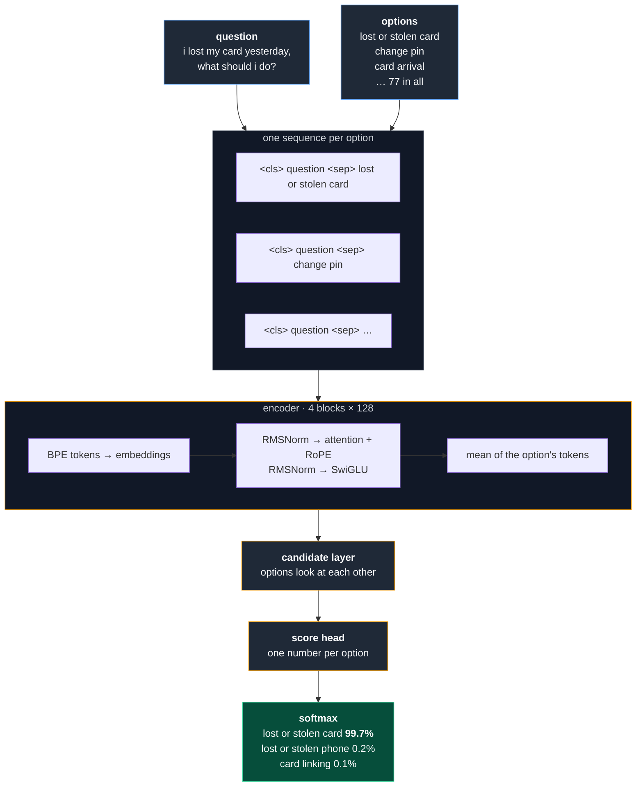
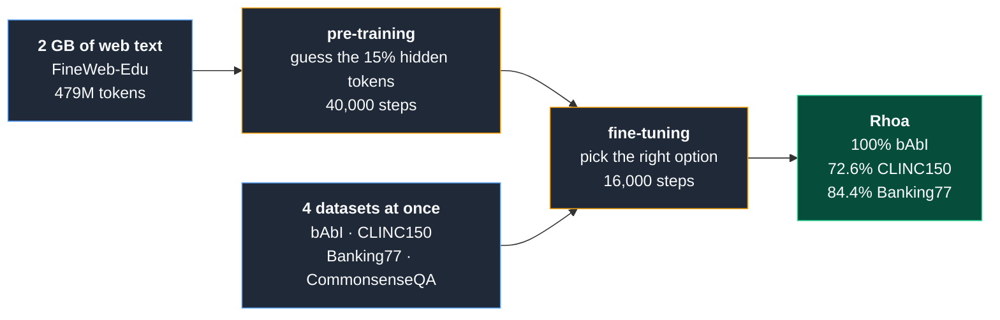

# Rhoa · the model that reads

[← README](../README.md) · [Mēlon →](melon.md) · [Data](02-data.md)

Rhoa takes a text and its options, and gives every option a score. The highest score is the decision.

## How it was trained

## Specs (the best Rhoa, `rhoa_web2`)

| | |
|---|---|
| Weights | 2.36 M |
| Encoder | 4 blocks, 128 wide, 4 attention heads |
| Block | RMSNorm, self-attention with rotary positions (RoPE), SwiGLU |
| Candidate layer | 1 block over the options, no positions |
| Tokenizer | byte-level BPE, 8,192 tokens, trained on the web text (`tiny_dlm/tokenizer.py`) |
| Input | up to 128 tokens per `<cls> context <sep> option` |
| Options | any number: 2 for bAbI, 151 for CLINC150 |
| Pre-training | masked tokens, 128 windows of 127 tokens per step, 40,000 steps |
| Fine-tuning | 4 datasets mixed, at most 16 options per question in training, all options at test |
| Code | `tiny_dlm/model.py` (`TinyDLM`, also `Rhoa`) |

Also trained, for the benchmark: a 2 × 64 version, a version with GPT-2 blocks (LayerNorm, learned positions, GELU),
word-tokenizer versions, and a twin of each without pre-training. Results are in the [README](../README.md#results).
